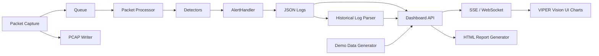

# VIPER Vision — Network Intrusion Detection and Visualization

VIPER Vision is a real-time Network Intrusion Detection and Visualization platform built in Python. It captures network traffic, detects port scans, floods, brute-force attempts, and statistical anomalies, then visualizes suspicious activity through a modern dashboard with alert timelines, protocol analytics, top talkers, suspicious connection grouping, PCAP exports, and professional reports.

VIPER remains defensive and monitoring-focused. Use it only on networks where you have explicit permission to capture and analyze traffic.

---

## Table of Contents

1. [Features](#features)
2. [Architecture Overview](#architecture-overview)
3. [Directory Structure](#directory-structure)
4. [Requirements](#requirements)
5. [Installation](#installation)
6. [Configuration](#configuration)
7. [Usage](#usage)
8. [Detection Capabilities](#detection-capabilities)
9. [Alerting Channels](#alerting-channels)
10. [Web Dashboard](#web-dashboard)
11. [Reporting &amp; Visualisation](#reporting--visualisation)
12. [PCAP Export](#pcap-export)
13. [Running Tests](#running-tests)
14. [Docker Deployment](#docker-deployment)
15. [Architecture Decisions](#architecture-decisions)
16. [Future Improvements](#future-improvements)

---

## Features

| Category | Capability |
| --- | --- |
| **Detection** | Port scan, SYN flood, UDP flood, ICMP flood, brute-force, anomaly |
| **Windowing** | Thread-safe sliding-window counters — no stale state |
| **Severity** | Dynamic severity escalation (LOW → CRITICAL) based on rate |
| **Alerting** | Console (coloured), rotating JSON log, email, webhook |
| **Capture** | Rotating PCAP export for offline forensics |
| **Config** | Single YAML file — no code changes needed to tune thresholds |
| **Dashboard** | VIPER Vision dashboard with overview, live alerts, protocol analytics, top talkers, port scans, suspicious connections, timeline, reports, captures, settings |
| **Streaming** | SSE live updates plus optional WebSocket routes via `flask-sock` |
| **Reporting** | Text + JSON reports, Matplotlib charts, VIPER Vision HTML reports |
| **Testing** | Full pytest suite; no live interface needed |
| **Docker** | Single-command deployment with docker-compose |

---

## Architecture Overview

```text
┌─────────────────────────────────────────────────────────────┐
│                        main.py (CLI)                        │
└──────────────────────────┬──────────────────────────────────┘
                           │
                    ┌──────▼──────┐
                    │  NIDSEngine │  (src/core/engine.py)
                    └──────┬──────┘
          ┌────────────────┼────────────────┐
          │                │                │
   ┌──────▼──────┐  ┌──────▼──────┐  ┌─────▼──────┐
   │   Scapy     │  │  Rotating   │  │  Reporter  │
   │   sniff()   │  │  PcapWriter │  │ Visualizer │
   └──────┬──────┘  └─────────────┘  └────────────┘
          │ enqueue()
   ┌──────▼────────────────────────────────────────┐
   │          PacketProcessor (queue + N workers)  │
   └──────┬────────────────────────────────────────┘
          │ process(packet)
   ┌──────▼────────────────────────────────────────────────────┐
   │  Detectors                                                │
   │  PortScanDetector  SynFloodDetector  UdpFloodDetector     │
   │  IcmpFloodDetector  BruteForceDetector  AnomalyDetector   │
   └──────┬────────────────────────────────────────────────────┘
          │ emit(Alert)
   ┌──────▼──────────────────────────────────────────────────┐
   │  AlertHandler  →  Console / File / Email / Webhook      │
└─────────────────────────────────────────────────────────┘
                         │ JSON logs
                         ▼
┌─────────────────────────────────────────────────────────┐
│ VIPER Vision Dashboard API → SSE/WebSocket → UI Charts  │
└─────────────────────────────────────────────────────────┘
```



**Key design principles:**

- **Separation of concerns** — each module has a single responsibility.
- **Dependency injection** — detectors receive `AlertHandler` via constructor; no globals.
- **Non-blocking capture** — Scapy's callback only enqueues packets; all processing is in worker threads.
- **Configurable everything** — all thresholds, windows, and channels live in `config/config.yaml`.

---

## Directory Structure

```text
viper/
├── main.py                      # CLI entry point
├── requirements.txt
├── pytest.ini
├── Dockerfile
├── docker-compose.yml
├── config/
│   └── config.yaml              # ← edit this to tune the system
├── dashboard/
│   ├── app.py                   # VIPER Vision Flask dashboard/API
│   ├── api/
│   │   └── models.py
│   ├── services/
│   │   ├── log_parser.py
│   │   ├── metrics_service.py
│   │   ├── timeline_service.py
│   │   ├── suspicious_connection_service.py
│   │   ├── demo_data.py
│   │   └── report_service.py
│   ├── static/
│   └── templates/
├── src/
│   ├── core/
│   │   ├── engine.py            # Top-level orchestrator
│   │   ├── packet_processor.py  # Queue + worker thread pool
│   │   └── sliding_window.py    # Thread-safe time-windowed counters
│   ├── detectors/
│   │   ├── base.py              # Abstract BaseDetector
│   │   ├── port_scan.py
│   │   ├── flood_detectors.py   # SYN / UDP / ICMP
│   │   ├── brute_force.py
│   │   └── anomaly.py           # Statistical (Welford's algorithm)
│   ├── alerting/
│   │   ├── alert.py             # Alert dataclass + Severity enum
│   │   └── handler.py           # Fan-out dispatcher
│   ├── logger/
│   │   └── logger.py            # Structured JSON + coloured console
│   ├── reporting/
│   │   └── reporter.py          # Text/JSON reports + Matplotlib charts
│   ├── capture/
│   │   └── pcap_writer.py       # Rotating PCAP export
│   └── utils/
│       └── config_loader.py     # YAML loader with deep-merge defaults
└── tests/
    └── test_detectors.py        # Full pytest suite
```

---

## Requirements

- Python 3.9+
- Linux, macOS, or Windows
- Scapy requires raw-socket access:
  - **Linux / macOS**: Root (`sudo`) or `CAP_NET_RAW` privilege
  - **Windows**: [Npcap](https://npcap.com/) installed (ensure "WinPcap API-compatible mode" is checked) and run terminal as Administrator

---

## Installation

```bash
# 1. Clone the repository
git clone https://github.com/Ayaan-22/viper.git
cd viper

# 2. Create a virtual environment (recommended)
python -m venv .venv

# On Linux / macOS (bash/zsh):
source .venv/bin/activate

# On Windows (PowerShell):
.\.venv\Scripts\Activate.ps1

# On Windows (Command Prompt):
.\.venv\Scripts\activate.bat

# 3. Install dependencies
python -m pip install --upgrade pip
pip install -r requirements.txt
```

---

## Configuration

All settings live in **`config/config.yaml`**.
Edit the file — no code changes required.

```yaml
detection:
  port_scan:
    enabled: true
    unique_ports_threshold: 15   # ports within window before alerting
    window_seconds: 10

  syn_flood:
    packets_per_second: 100      # rate threshold

  brute_force:
    target_ports: [22, 3389]     # which services to watch
    attempts_threshold: 10
    window_seconds: 30

alerting:
  email:
    enabled: true
    smtp_host: smtp.gmail.com
    username: you@gmail.com
    password: "app-password"
    to_addrs: [soc@company.com]
    min_severity: HIGH

  webhook:
    enabled: true
    url: https://hooks.slack.com/services/...
```

---

## Usage

The `main.py` script is the primary entry point for the VIPER NIDS Engine. It provides several commands and flags to control the intrusion detection system.

> [!IMPORTANT]
> **Windows Users:** You **must** run your Command Prompt or PowerShell as **Administrator** to capture packets. You do not use `sudo`.

### 1. Finding Your Network Interface

Before starting the monitor, you must determine which network interface to listen on.

**On Linux / macOS:**

```bash
# Scapy requires root privileges to list network interfaces on Linux
sudo .venv/bin/python main.py --list-interfaces
```

**On Windows (Run terminal as Administrator):**

```powershell
python main.py --list-interfaces
```

*Note the "Name" or "Index" of the adapter that connects to your local network (e.g., `eth0` on Linux, `"Ethernet"` or `"Wi-Fi"` on Windows).*

### 2. Starting the NIDS Engine

Use the `-i` (or `--interface`) flag to start live capture.

**On Linux / macOS:**
If you are running in a virtual environment, running `sudo python` uses the system Python. You must explicitly pass the path to the virtual environment's Python binary to keep the installed dependencies:

```bash
sudo .venv/bin/python main.py -i eth0
```

**On Windows (Run as Administrator):**

```powershell
# In PowerShell:
python main.py -i "Ethernet"

# Alternatively, use the interface index:
python main.py -i 15
```

### 3. CLI Flags & Options Reference

| Flag / Option | Description | Example Usage |
| --- | --- | --- |
| `-i`, `--interface` | The network interface to capture traffic from. Overrides the config file. | `-i eth0` or `-i "Wi-Fi"` |
| `-c`, `--config` | Path to a custom YAML configuration file. Defaults to `config/config.yaml`. | `-c /etc/nids/prod.yaml` |
| `--log-level` | Override the logging level (DEBUG, INFO, WARNING, ERROR, CRITICAL). | `--log-level DEBUG` |
| `--list-interfaces` | List all available network interfaces on the host system and exit. | `--list-interfaces` |
| `--dry-run` | Validates your config file and prints active detectors without starting a capture. | `--dry-run` |
| `--report-only` | Do not capture traffic. Instead, parse an existing log file and generate a report. | `--report-only` |
| `--log` | Specify the path to the log file to parse when using `--report-only`. | `--log logs/nids.log` |
| `--no-color` | Disables ANSI colour output in the terminal console. | `--no-color` |

### 4. Advanced Examples

**Run with a custom configuration file and maximum verbosity:**

```bash
# Linux (using the venv Python)
sudo .venv/bin/python main.py -i eth0 -c config/high_security.yaml --log-level DEBUG

# Windows (Run as Administrator)
python main.py -i "Wi-Fi" -c config/high_security.yaml --log-level DEBUG
```

**Validate your configuration without starting the engine:**

```bash
python main.py --dry-run
```

**Post-Incident Analysis:**
If your NIDS crashed or was stopped, you can generate an HTML/PDF/Text report purely from the saved JSON logs without sniffing new packets.

```bash
python main.py --report-only --log logs/nids_yesterday.log
```

### Help Menu

To view the built-in help menu at any time, run:

```bash
python main.py --help
```

---

## Detection Capabilities

### Port Scan

Watches for a single source IP probing many distinct destination ports within a sliding window using SYN-only packets.  Whitelisted IPs and non-SYN traffic are ignored to reduce false positives.

### SYN / UDP / ICMP Flood

Measures per-source packet rate over a 1-second sliding window.  Severity escalates to CRITICAL when the rate exceeds twice the configured threshold.

### Brute Force

Counts connection attempts to configurable service ports (SSH, RDP, FTP, Telnet, SMTP, POP3, IMAP) per source over a 30-second window.  Fires a HIGH alert when the attempt count exceeds the threshold.

### Statistical Anomaly

Uses **Welford's online algorithm** to maintain a per-source running mean and standard deviation of packet sizes and inter-arrival times — with no ML library required.  Alerts when a new observation deviates by more than `deviation_factor` (default: 3.0) standard deviations from the learnt baseline.

---

## Alerting Channels

| Channel | Config key | Notes |
| --- | --- | --- |
| Coloured console | `alerting.console` | Colour-coded by severity |
| Rotating JSON log | `logging.file` | Structured, queryable with `jq` |
| Email (SMTP) | `alerting.email` | TLS, per-severity filter |
| HTTP Webhook | `alerting.webhook` | Slack / Teams / PagerDuty compatible |

**Query the log with `jq`:**

**On Linux / macOS (bash/zsh) or Windows Git Bash:**

```bash
# All CRITICAL alerts
jq 'select(.severity=="CRITICAL")' logs/nids.log

# Top offending IPs
jq -r '.src_ip' logs/nids.log | sort | uniq -c | sort -rn | head
```

**On Windows (PowerShell):**

```powershell
# All CRITICAL alerts (note the escaped double quotes)
jq "select(.severity==`"CRITICAL`")" logs/nids.log

# Top offending IPs (native PowerShell)
jq -r ".src_ip" logs/nids.log | Group-Object | Sort-Object Count -Descending | Select-Object -First 10 -ExpandProperty Name
```

---

## Web Dashboard

VIPER Vision features a web-based intrusion visualization dashboard to monitor network traffic in real-time or replay historical logs. It supports two modes: **Live Monitoring Mode** and **Demo Mode**.

### 1. Live Monitoring Mode

In this mode, the NIDS engine captures traffic and writes alerts in real-time to a JSON log file. The dashboard monitors this log file, streaming alerts and traffic metrics to the web UI using **Server-Sent Events (SSE)** or **WebSockets** (requires `flask-sock`).

To run in Live Monitoring Mode, you need to open two terminal windows (both in the active virtual environment):

#### Step A: Start the NIDS Sensor Engine

Start the packet capture engine to sniff network traffic and generate logs.

- **Linux / macOS:**

  ```bash
  sudo .venv/bin/python main.py -i eth0
  ```

- **Windows (Run terminal as Administrator):**

  ```powershell
  python main.py -i "Ethernet"
  ```

#### Step B: Start the VIPER Vision Dashboard

Run the Flask dashboard web server.

- **Option 1: Via the main CLI (Recommended)**

  ```bash
  python main.py --dashboard
  ```

- **Option 2: Running the dashboard app directly**

  ```bash
  python dashboard/app.py --log logs/nids.log --port 5000
  ```

### 2. Demo Mode

If you want to explore the dashboard features without running packet capture or requiring elevated administrative/root privileges, you can run the dashboard in **Demo Mode**. This populates the UI with simulated, high-fidelity security events (such as port scans, floods, and brute-force attempts).

- **Option 1: Via the main CLI**

  ```bash
  python main.py --dashboard-demo
  ```

- **Option 2: Running the dashboard app directly**

  ```bash
  python dashboard/app.py --demo
  ```

---

### Dashboard Features & Capabilities

Open **`http://localhost:5000`** in your browser to access the interface. The dashboard includes:

- **Overview Panel**: Real-time traffic summary cards, alert statistics, engine status, and active system notifications.
- **Live Alerts Feed**: Chronological list of triggered alerts with inline filters (by severity, detector, or protocol), search bar, pause/resume controls, and expandable details showing deep packet evidence.
- **Packet Summary**: Dynamic graphs tracking packet capture status, processing queues, and drop rates.
- **Top Talkers**: Interactive lists and charts of the most active source IPs, destination IPs, and targeted ports.
- **Protocol Breakdown**: Visual charts showing traffic distribution across TCP, UDP, ICMP, and other protocols.
- **Port Scan Visualizer**: Highlights probe origins, unique targeted ports count, and scanning activity timelines.
- **Suspicious Connections**: Automatically groups related flows by source IP, destination IP, and detection profile.
- **Attack Timeline**: Interactive timeline illustrating the progression and severity escalation of attacks.
- **Reports & Captures Management**: View, download, or trigger new HTML reports and inspect captured `.pcap` files directly from the UI.
- **Settings Control**: Adjust refresh intervals, log file paths, maximum alert display limits, and visual themes.

---

### Real-Time Update Channels

The dashboard supports two channels for pushing live data updates to the client:

1. **Server-Sent Events (SSE)** (Default): Built-in and works out-of-the-box using the `/api/stream/alerts` and `/api/stream/metrics` routes.
2. **WebSockets** (Recommended for lower overhead): Triggered automatically if `flask-sock` is installed, utilizing `/ws/alerts` and `/ws/metrics` routes. If `flask-sock` is not available, the dashboard gracefully falls back to SSE.

---

## Reporting & Visualisation

Reports are generated automatically every `reporting.auto_report_interval` seconds and on shutdown.
VIPER Vision can also generate a polished HTML report from the dashboard:

**On Linux / macOS or Windows CMD:**

```bash
curl -X POST http://localhost:5000/api/reports/generate
```

**On Windows (PowerShell):**

```powershell
Invoke-RestMethod -Method Post -Uri http://localhost:5000/api/reports/generate
```

```text
reports/
├── report_20250101_120000.txt   # Human-readable summary
├── report_20250101_120000.json  # Machine-readable (for SIEM ingestion)
├── viz_20250101_120000.png      # Bar chart: alerts by detector
└── severity_20250101_120000.png # Pie chart: alerts by severity
```

---

## PCAP Export

Packets are written to rotating PCAP files in `captures/`:

```bash
# Analyse with Wireshark (ensure Wireshark is in your system PATH, or simply double-click the .pcap file in Windows Explorer)
wireshark captures/capture_20250101_120000.pcap

# Or with tshark
tshark -r captures/capture_20250101_120000.pcap -Y "tcp.flags.syn==1"
```

---

## Running Tests

```bash
# All tests
pytest

# With coverage
pytest --cov=src --cov-report=term-missing

# A specific test class
pytest tests/test_detectors.py::TestPortScanDetector -v
```

Tests cover: `SlidingWindow`, `SlidingWindowDict`, `Alert`/`Severity`, `AlertHandler`, all detectors, and `ConfigLoader`.  No live network interface is required.

---

## Docker Deployment

> [!NOTE]
> Modern Docker installations use `docker compose` without the hyphen. For older versions, replace `docker compose` with `docker-compose`.

```bash
# 1. Build the Docker images
docker compose build

# 2. Start all services (NIDS sensor + dashboard) in the background
docker compose up -d

# 3. View live logs from the NIDS sensor
docker compose logs -f nids

# 4. Capture on a different interface
docker compose run nids --interface ens3

# 5. Run only the no-capture dashboard demo on http://localhost:5050
docker compose --profile demo up dashboard-demo

# 6. Stop and clean up containers
docker compose down
```

The sensor container requires `NET_ADMIN` and `NET_RAW` for Scapy packet capture. Host networking may be required for real capture visibility, especially on Linux; Docker Desktop on Windows/macOS has additional network capture limitations. The dashboard and demo services do not require raw socket privileges.

---

## Architecture Decisions

| Decision | Rationale |
| --- | --- |
| **Sliding windows over fixed counters** | Counters reset at arbitrary boundaries causing bursts to split across windows; sliding windows give a continuous view |
| **Thread-pool + queue** | Decouples capture (must be fast) from detection (may be slow); bounded queue prevents OOM under extreme load |
| **Welford's algorithm** | Single-pass, O(1) per sample, numerically stable — no need for NumPy or keeping a full history buffer |
| **Dependency injection** | Detectors are completely testable without Scapy or a network interface |
| **YAML config + deep-merge** | Users can supply a partial config; missing keys always fall back to safe defaults |
| **JSON structured logs** | Machine-parseable; trivially ingested by ELK, Splunk, Grafana Loki, or `jq` |
| **Bounded memory management** | Auto-eviction of IPs and bounded queues prevent Out Of Memory (OOM) crashes during sustained DDoS |
| **Burst-resistant rate calculation** | Sliding windows use full window duration instead of instantaneous elapsed time, ignoring OS packet buffer bursts |

---

## Future Improvements

- **ML anomaly model** — replace Welford's with an `sklearn` IsolationForest or autoencoder trained on baseline traffic captures.
- **GeoIP enrichment** — annotate alerts with country/ASN using `maxminddb`.
- **eBPF integration** — use `bcc` or `pyshark` for kernel-space filtering to reduce Python-side overhead by 10×.
- **Prometheus metrics** — expose packet rates and alert counts as a `/metrics` endpoint for Grafana dashboards.
- **Alert deduplication** — group repeated alerts from the same source into a single aggregated event.
- **IPv6 support** — extend all detectors to handle IPv6 headers.
- **Cluster mode** — distribute capture across multiple sensors and aggregate alerts centrally.

---

## Skills Demonstrated

- Network intrusion detection
- Packet analysis
- Scapy-based traffic capture
- Sliding-window detection algorithms
- Real-time alerting
- SSE/WebSocket dashboard streaming
- Security dashboard development
- Log analytics
- Protocol breakdown
- Attack timeline visualization
- Python backend engineering
- Docker deployment
- Testing and documentation
