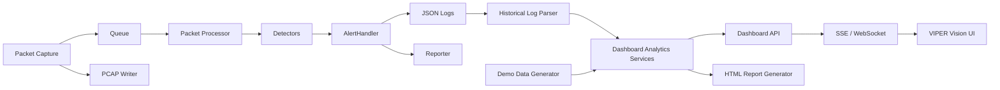

# VIPER Vision Architecture

The Scapy capture callback remains lightweight: it only enqueues packets and writes PCAP data. Detection continues through the existing queue, worker threads, detectors, `AlertHandler`, JSON logs, and reports.

VIPER Vision consumes the existing log pipeline. It normalizes alert records and `packet_stats` records, then derives top talkers, protocol distribution, timeline events, suspicious connection groups, port-scan views, and report summaries.

This preserves the original NIDS engine while adding a richer visualization layer.
